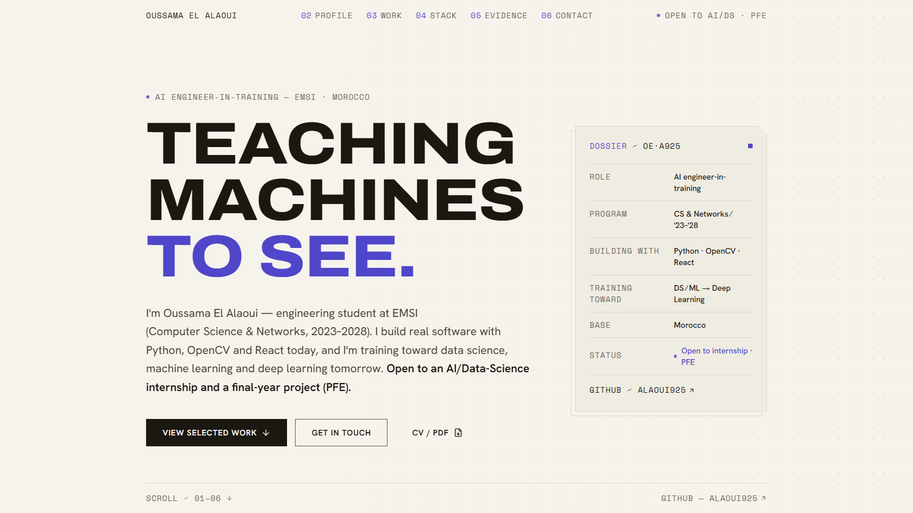
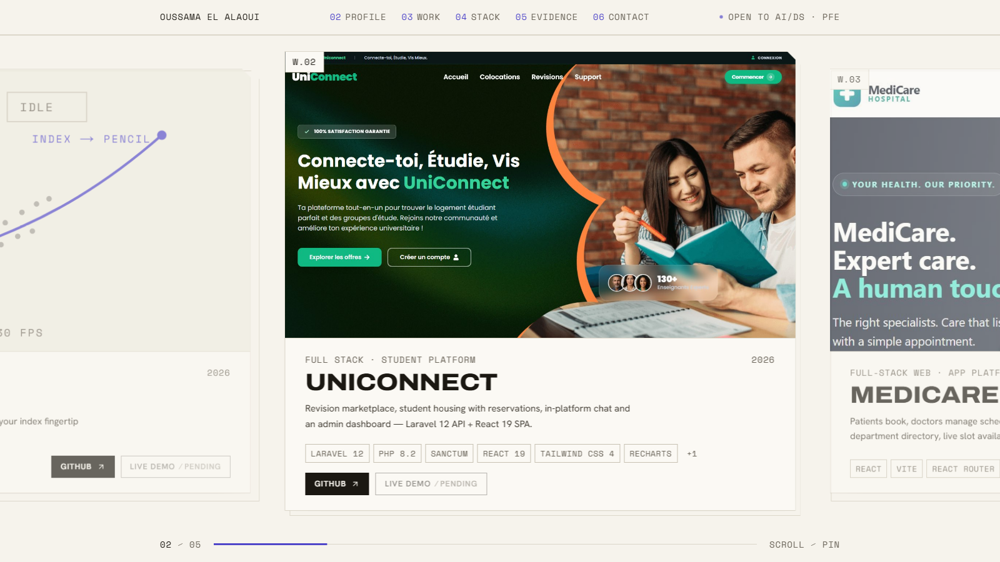

# Oussama El Alaoui — Portfolio

[](https://nextjs.org)
[](https://www.typescriptlang.org)
[](https://react.dev)
[](https://tailwindcss.com)
[](#performance--accessibility)
[](LICENSE)

**Live:** [os-portfolio-chi.vercel.app](https://os-portfolio-chi.vercel.app) ·
**GitHub:** [@Alaoui925](https://github.com/Alaoui925)

Portfolio of Oussama El Alaoui — engineering student in Computer Science &
Networks at EMSI (2023 – 2028), training toward AI. Every project shown links
to a real public repository, and the portfolio itself lives in this repo.



---

## Design direction — "Digital Atlas"

A single, deliberate look applied across every section; no default palettes or
system fonts.

- **One theme, warm and light** — cream paper, warm-tinted ink and a single
  Majorelle-blue accent (`#F6F3EC` paper → `#1B1812` ink → `#4F46C9` voice).
- **Chamfered cards** — a zellige-inspired 45° corner cut on surfaces,
  index-numbered sections (`02 PROFILE`, `03 WORK`, …).
- **Self-hosted type** — Archivo (display), Hanken Grotesk (body),
  Space Mono (micro-labels).
- Researched from Awwwards references before any UI was written; every
  colour, radius, shadow and spacing step is a CSS variable in
  [`app/globals.css`](app/globals.css).



## What's inside

Six numbered sections, progressive disclosure from identity to contact:

| # | Section | What it does |
|---|---------|--------------|
| 01 | Homepage | Positioning statement, dossier card, primary actions (work / contact / CV) |
| 02 | Profile | Education record, training path, what I'm looking for |
| 03 | **Work** | Scroll-pinned **horizontal showcase** — five projects as full cards |
| 04 | Stack | Evidence-based technology list, not word soup |
| 05 | Evidence | Verified achievements and counters |
| 06 | Contact | Real channels only — GitHub, email, CV download |

## The work showcase

The signature interaction of the site (section 03):

- Vertical scroll drives a **pinned rail** of five project cards
  right-to-left, then releases; reverses on scroll-up, no native horizontal
  scrollbar. Mapping is a measured, near 1:1 scroll → translate relationship,
  spring-smoothed with `motion` (no GSAP dependency).
- Cards carry a **16 : 9 media slot** with top-left anchored crops, an
  `01 / 05` counter with progress hairline, active-card emphasis
  (neighbours dim to 0.65), stack tags, and action buttons.
- **Every link is real.** Repositories link to GitHub. Live-demo buttons
  only render where a deployment was verified: [MediCare](https://hospital-reservation-ecru.vercel.app/)
  and [Woodora](https://woodora-store.vercel.app/); everywhere else the card
  shows a disabled `live demo / pending` chip rather than a dead link.
- **Graceful everywhere:** below 768 px and under `prefers-reduced-motion`
  the rail degrades to a stacked, static layout; keyboard users can tab to
  off-screen cards and the page snaps them into view.

## Tech stack

| Layer | Choice |
|---|---|
| Framework | Next.js 15 (App Router), **static export** → `out/` |
| Language | TypeScript (strict), React 19 |
| Styling | Tailwind CSS 4, CSS-variable design tokens, no default palette |
| Interaction | `motion` (Framer) — scroll rail, reveals, counters |
| Components | shadcn-style `Button` / `Badge` re-seated on atlas tokens; Magic UI ports (`Marquee`, `NumberTicker`, `BlurFade`, `DotPattern`) |
| Content | `lib/data/*.ts` — single source of truth for profile, projects, skills, timeline |
| Fonts | Self-hosted via `next/font` (Archivo, Hanken Grotesk, Space Mono) |

## Content integrity

Because a portfolio is itself evidence of judgement, the content follows
strict rules:

- Project descriptions are audited against each repository's README —
  never invented. Where a repo lacks useful documentation (UniConnect,
  Woodora), the card carries a visible `repo README pending` note and the
  copy comes from a code audit.
- Experience and achievements are verified records only; counters in the
  Evidence section are real numbers.
- Contact links exist and are checked. There are no placeholders or fake
  URLs anywhere in `lib/data/`.

## Performance & accessibility

- **171 kB first-load JS** measured on the production build (no analytics,
  no fonts round-trip), fully static — no server, no database.
- WCAG AA targets: informative text ≥ 4.5 : 1, focus is a 2 px Majorelle
  ring, text floors at 14 px.
- `prefers-reduced-motion` is honoured twice: a CSS fallback in
  `globals.css` **and** `MotionConfig reducedMotion="user"` at the app root.
- Semantic markup throughout (`section` / `article` / labelled headings,
  alt text, decorative progress UI marked `aria-hidden`).
- SEO: typed metadata (`metadataBase`), `sitemap.xml`, `robots.txt`,
  JSON-LD person profile.

## Getting started

```bash
npm install
npm run dev        # http://localhost:3000
npm run build      # type-check + static export → out/
npm run typecheck  # tsc --noEmit
```

To preview the production export locally:

```bash
npx serve out
```

## Project structure

```
app/              layout (fonts, tokens, metadata, JSON-LD), page.tsx, globals.css
components/
  layout/         TopBar (numbered nav), Footer (ink band)
  sections/       Hero, MarqueeStrip, About, Work (pinned showcase),
                  Stack, Evidence, Contact, SectionLabel
  magicui/        Marquee, NumberTicker, BlurFade, DotPattern
  motion/         MotionProvider (global reduced-motion contract)
  ui/             Button, Badge (tokened shadcn primitives)
lib/
  data/           profile.ts, projects.ts, skills.ts, timeline.ts
  utils.ts
scripts/          Playwright verification harnesses
_legacy/          previous Vite build, kept for reference (see git history)
```

Everything the site renders lives in `lib/data/` — updating a project,
link or achievement is a one-file edit, and the UI follows.

## Verification

`scripts/verify-exhibit.cjs` and `scripts/verify-media-ratio.cjs` drive the
built site with Playwright and assert the rail's behaviour:

- pin holds across the whole runway; scroll→translate mapping stays linear
- counter `01 → 05`, active-card order, progress bar end-state
- keyboard focus pulls off-screen cards into view
- no horizontal scrollbar at desktop, tablet and mobile widths
- stacked fallbacks (< 768 px, reduced motion) render correctly
- zero console errors on every viewport profile

Run against a local preview server (`npx serve out`) with
`NODE_PATH="$(npm root -g)"`.

## Deployment

`npm run build` produces a fully static `out/` directory — deployable to any
static host or CDN. The portfolio deploys **on Vercel**, which rebuilds the
export automatically on every push to `main`:
[os-portfolio-chi.vercel.app](https://os-portfolio-chi.vercel.app).

## Author

**Oussama El Alaoui** — engineering student, CS & Networks @ EMSI (Morocco),
open to AI / Data-Science internships and final-year projects (PFE).

- GitHub: [@Alaoui925](https://github.com/Alaoui925)
- Email: elalaouioussama2002@gmail.com
- CV: [download](https://os-portfolio-chi.vercel.app/cv.pdf)

© 2026 Oussama El Alaoui. Code released under the
[MIT License](LICENSE); the design and written content are personal work.
